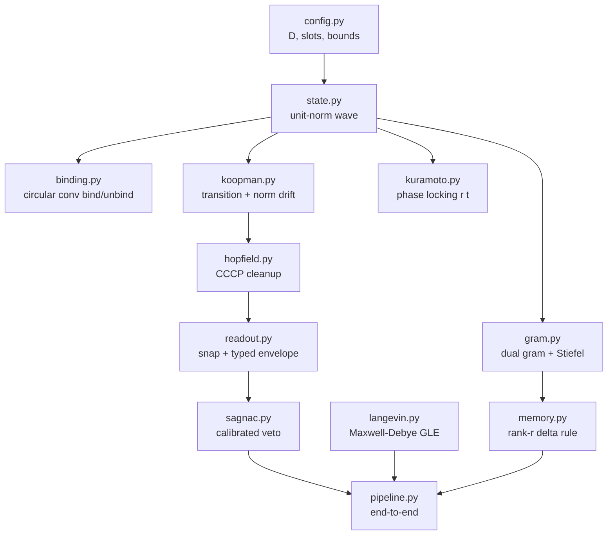

# Architecture

## Levels

```text
L0  Thermodynamic boundary      active-inference loop (interface only)
L1  Tri-zone topology           ingress -> resonator -> memory -> egress
L2  State space                 complex unit hypersphere; 4-slot partition
L3  Dynamics                    Koopman + Kuramoto + GLE
L4  Verification                calibrated Sagnac veto; delta memory
L5  Hardware                    BLOCKED on this host (CPU)
```

## Module map



## Frozen interfaces

- `WaveConfig` is the single source of truth for dimensions and bounds.
- `WaveState` is the only currency between modules.
- Every stochastic path takes an explicit seed or `numpy.random.Generator`.
- Every operator that touches `psi` must leave `||psi|| = 1` to 1e-5.

## No dense `D x D` rule

`gram.py` computes only the dual `k x k` matrix (`k <= 256`).
`memory.py` stores only `[D, r]` factors (`r = 64`).
`assert_no_dense_dxd()` guards both.

## Slot partition

| Slot | Role | Fraction of D |
|---|---|---|
| 0 | entity / subject | 1/4 |
| 1 | action / predicate | 1/4 |
| 2 | target / object | 1/4 |
| 3 | context / axiom | 1/4 |
