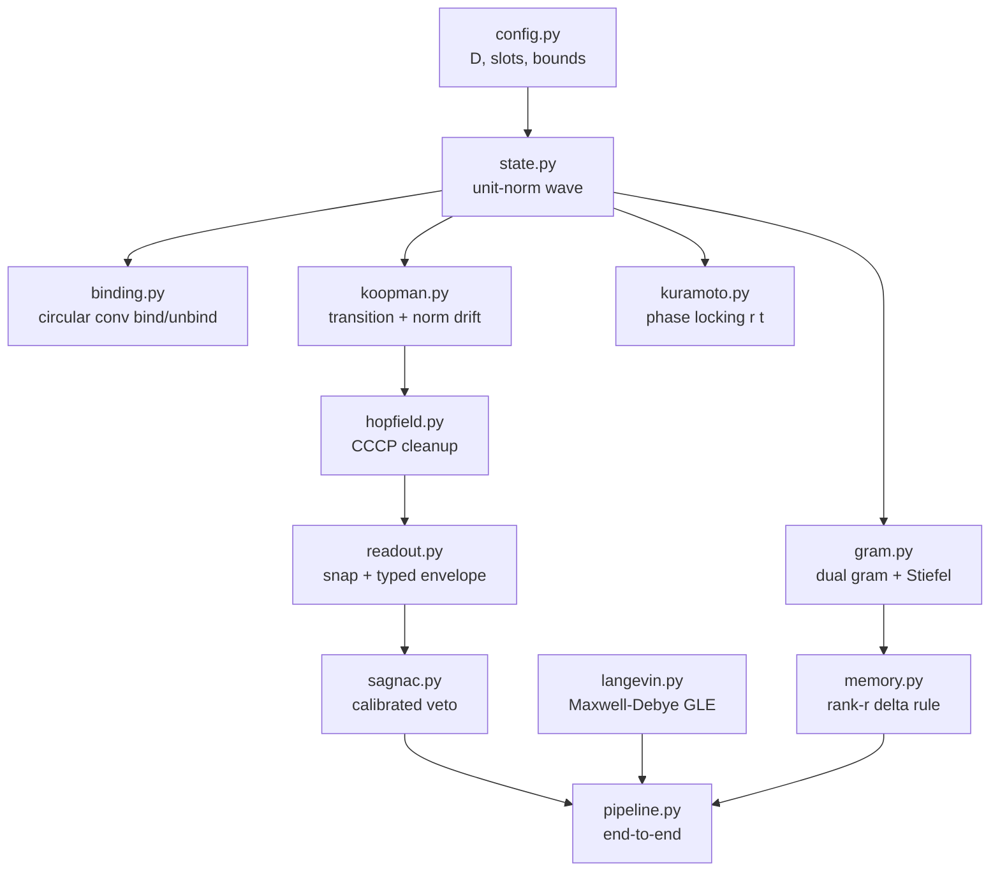

# Architecture

## Levels

```text
L0  Thermodynamic boundary      active-inference loop (interface only)
L1  Tri-zone topology           ingress -> resonator -> memory -> egress
L2  State space                 complex unit hypersphere; 4-slot partition
L3  Dynamics                    Koopman + Kuramoto + GLE
L4  Verification                calibrated Sagnac veto; delta memory
L5  Hardware                    BLOCKED on this host (CPU)
```

## Module map



## Frozen interfaces

- `WaveConfig` is the single source of truth for dimensions and bounds.
- `WaveState` is the only currency between modules.
- Every stochastic path takes an explicit seed or `numpy.random.Generator`.
- Every operator that touches `psi` must leave `||psi|| = 1` to 1e-5.

## No dense `D x D` rule

`gram.py` computes only the dual `k x k` matrix (`k <= 256`).
`memory.py` stores only `[D, r]` factors (`r = 64`).
`assert_no_dense_dxd()` guards both.

## Slot partition

| Slot | Role | Fraction of D |
|---|---|---|
| 0 | entity / subject | 1/4 |
| 1 | action / predicate | 1/4 |
| 2 | target / object | 1/4 |
| 3 | context / axiom | 1/4 |
## Three-zone holarch (v0.9)

The v6 kernel above is the physics core. The holarch is the inference
system built on it, and it is additive: no v6 module changed.

```text
Zone A  henri/holarch/zone_a.py   lean swarm, fast weights, DAgger, replay
Zone B  henri/holarch/zone_b.py   BaTiO3 plates, slot mixer, Stiefel pool
Zone C  henri/holarch/zone_c.py   engram store, Gram index, pager, decay
wiring  henri/holarch/pipeline.py encoders -> bind -> C -> B -> veto -> A
budget  henri/holarch/budget.py   counted params + measured saved tensors
```

Phase-1 severs the sensor skip (skip_alpha = 0) so the task gradient
reaches the phase masks and the heater controller through the optical
path only. The readout is slot-specific Hermitian unbinding on four
Stiefel bases, and the cross-slot coupler is a Cayley-unitary 4x4
mixer between plates.

The data path and the measured results are in
[HOLARCH.md](HOLARCH.md). The v6 evidence policy applies unchanged: a
pytest pass is code-health evidence, and no holarch number is a
capability claim.

Hardware mapping, stated as a design intent rather than a measurement:

| Zone | Silicon target | Implemented as |
|---|---|---|
| A | ASIC swarm of lean learners | torch experts with rank-r fast weights |
| B | BaTiO3 photonic crystal, Sagnac loop, microheaters | differentiable digital twin |
| C | NVMe M.2 module hosting TimescaleDB | real hypertable, SQLite fallback |

Zone B is a simulation. It is not a fabricated device and the document
says so at every claim.
